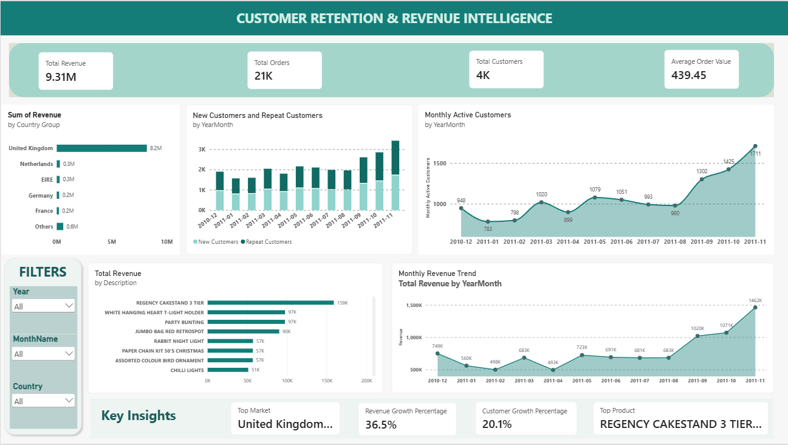

# Sales & Revenue Intelligence Dashboard

An interactive Power BI dashboard built to analyse retail sales, revenue performance, product performance and customer activity using the Online Retail dataset.

## Dashboard Preview

## Project Overview

This project transforms raw retail transaction data into meaningful business insights through an interactive Power BI dashboard. It focuses on understanding revenue trends, identifying top-performing products and markets, and tracking monthly changes in customer activity.

## Tools & Technologies

- **Power BI Desktop** – Dashboard development and visualisation
- **Power Query** – Data cleaning and transformation
- **DAX** – Measures, KPIs and business calculations
- **Microsoft Excel** – Source dataset

## Dataset

[Online Retail Dataset – UCI Machine Learning Repository](https://archive.ics.uci.edu/dataset/352/online+retail)

The dataset contains approximately 541,909 transaction records covering December 2010 to December 2011, with December 2011 containing only partial-month data (through 9 December).

## Dashboard Features

- Total Revenue, Total Orders, Total Customers and Average Order Value.
- Monthly Revenue Trend.
- Revenue Contribution by Country.
- Top 10 Products by Revenue.
- Monthly Active Customers.
- Month-over-Month Revenue and Customer Growth.
- Interactive Year, Month and Country slicers.
- Dynamic Top Product and Top Market contribution analysis.

## Key Findings

Based on the November 2011 reporting period:

- **Top Market:** United Kingdom.
- **Revenue Growth:** 37% compared with October 2011.
- **Customer Growth:** 20% compared with October 2011.

## Data Preparation

Data preparation and transformation using Power Query included:

- Checking duplicate records.
- Examining negative quantities and unit prices.
- Creating calculated Revenue and date-related columns.
- Creating a separate Date Table for time-based analysis.

## Key Metric Definitions

- **Average Order Value (AOV):** Total Revenue divided by Total Orders.
- **Monthly Active Customers:** Distinct customers who made at least one purchase during a month.
- **Revenue Growth:** Percentage change in revenue compared with the previous month.
- **Customer Growth:** Percentage change in monthly active customers compared with the previous month.

## Business Recommendations

- Monitor the contribution of the UK market to overall revenue.
- Identify opportunities to improve sales of high-performing products.
- Track monthly customer growth to understand changes in customer activity.

## Project Files

- `sales_revenue_intelligence.pbix` – Interactive Power BI dashboard.
- `dashboard_preview.png` – Dashboard screenshot.

## How to Explore

1. Download the `.pbix` file.
2. Open it using Power BI Desktop.
3. If required, update the source dataset location.
4. Use the interactive slicers to explore revenue and customer trends across different months and countries.

## Reporting Note

December 2011 was excluded because the available data for that month was incomplete. The dashboard therefore uses a consistent reporting period through November 2011.

---

**Developed as a Data Analytics Portfolio Project.**
